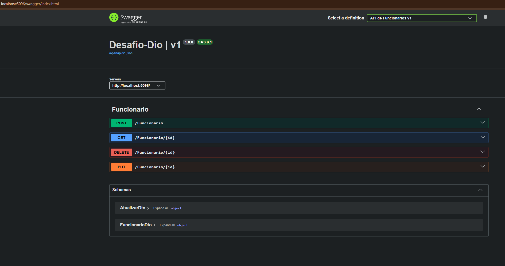
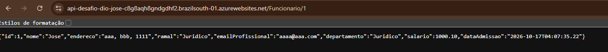
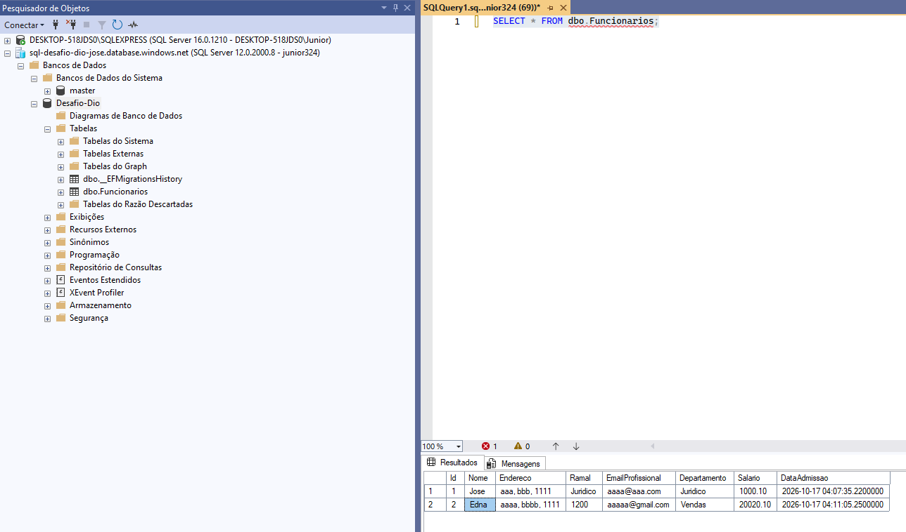
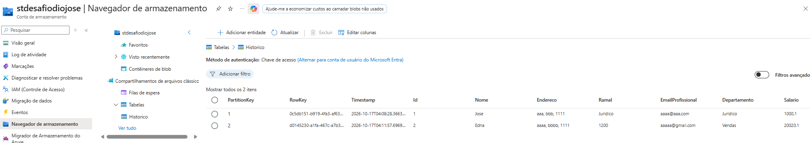

# API de Funcionários — .NET e Microsoft Azure

Web API de RH desenvolvida para o desafio **DIO — Trilha .NET — Nuvem com Microsoft Azure**. A aplicação permite cadastrar, consultar, atualizar e excluir funcionários, mantendo um histórico das alterações em um armazenamento separado.

O objetivo de aprendizado foi integrar uma API ASP.NET Core ao **Azure SQL Database**, ao **Azure Table Storage** e ao **Azure App Service**, com desenvolvimento local usando SQL Server Express e Azurite.

## Demonstração

### Endpoints no Swagger

Interface local com as quatro operações da API e os DTOs de entrada.



### API publicada no Azure App Service

Consulta ao endpoint `GET /Funcionario/1` pela URL pública do App Service, retornando os dados do funcionário em JSON.



### Funcionários no Azure SQL Database

Consulta à tabela `dbo.Funcionarios` pelo SSMS conectado ao servidor Azure. A estrutura inclui a tabela de controle das migrations do EF Core.



### Histórico no Azure Table Storage

Registros na tabela `Historico`, visualizados pelo navegador de armazenamento do portal Azure, com as chaves e os dados dos funcionários.



## Tecnologias

- C# e .NET 10.
- ASP.NET Core Web API.
- Entity Framework Core 10 e migrations.
- SQL Server Express / Azure SQL Database.
- Azure.Data.Tables e Azure Table Storage.
- Azurite para emulação local do Storage.
- OpenAPI e Swagger UI.
- Azure App Service para hospedagem.

## Organização

Um único projeto Web API, organizado por responsabilidade:

```text
Desafio-Dio/
├── Desafio-Dio.slnx
└── Desafio-Dio/
    ├── Controllers/   # Rotas, entrada de dados e respostas HTTP
    ├── Data/          # Contexto e mapeamento do EF Core
    ├── Migrations/    # Versionamento da estrutura SQL
    ├── Models/        # Entidade, DTOs, log e enum de ações
    ├── Services/      # Operações de negócio, persistência e histórico
    └── Program.cs     # Configuração e injeção de dependência
```

O controller recebe os DTOs e chama o service. A entidade `Funcionario` valida os dados no construtor e no método de alteração. O service coordena a persistência SQL e a gravação do histórico.

## Endpoints

| Método | Rota | Operação | Respostas previstas |
|---|---|---|---|
| GET | `/Funcionario/{id}` | Consulta por ID | `200`, `404` |
| POST | `/Funcionario` | Cria um funcionário | `201`, `400` |
| PUT | `/Funcionario/{id}` | Atualiza os dados permitidos | `204`, `400`, `404` |
| DELETE | `/Funcionario/{id}` | Exclui um funcionário | `204`, `404` |

O ID é gerado pelo banco. Criação, atualização e exclusão geram registros de histórico. O GET não gera log de alteração.

### Cadastro

Exemplo de corpo para `POST /Funcionario`, com dados fictícios:

```json
{
  "nome": "Ana Silva",
  "endereco": "Rua Exemplo, 100",
  "ramal": "204",
  "emailProfissional": "ana@example.com",
  "departamento": "Recursos Humanos",
  "salario": 4500.00,
  "dataAdmissao": "2026-10-01T00:00:00"
}
```

O POST retorna `201` sem corpo. Para consultar o registro, utilize o GET com o ID correspondente.

### Atualização

O PUT recebe todos os campos alteráveis. A data de admissão e o ID não são modificados por essa operação.

```json
{
  "nome": "Ana Silva",
  "endereco": "Rua Exemplo, 200",
  "ramal": "205",
  "emailProfissional": "ana@example.com",
  "departamento": "Financeiro",
  "salario": 5000.00
}
```

Os textos obrigatórios não podem ser vazios ou conter apenas espaços. O salário deve ser positivo, e a criação rejeita a data padrão de `DateTime`. A validação atual do email verifica seu preenchimento, sem validar o formato.

## Histórico no Table Storage

Os funcionários ficam no SQL, e o histórico fica na tabela **`Historico`** do Table Storage. A classe `Log` herda de `Funcionario` e implementa `ITableEntity`. Antes do envio, seus dados são mapeados para uma `TableEntity` com tipos compatíveis com o armazenamento.

| Campo | Representação |
|---|---|
| `PartitionKey` | ID do funcionário convertido em texto, agrupando seu histórico |
| `RowKey` | GUID gerado para cada registro |
| `TipoDeAcao` | Texto: `Criar`, `Atualizar` ou `Deletar` |
| `Salario` | Texto com cultura invariável, preservando a representação decimal |
| `DataAdmissao` | Dia da admissão à meia-noite, marcado como UTC sem conversão de fuso |
| `Timestamp` | Metadado preenchido pelo serviço de armazenamento |
| `ETag` | Metadado de versão gerenciado pelo serviço |

Cada log inclui também o ID e os demais dados do funcionário. Na atualização, registra os valores após a alteração. Na exclusão, utiliza o objeto carregado em memória para preservar os dados mesmo após a remoção do registro SQL.

Esses registros são **auditoria das alterações**, separados dos logs técnicos produzidos pela aplicação.

## Executar localmente

### Pré-requisitos

- SDK do .NET 10.
- SQL Server Express ou um Azure SQL Database acessível.
- Azurite com o serviço de tabelas ativo ou uma Storage Account compatível com Table Storage.
- Ferramenta `dotnet-ef` 10.x, preferencialmente alinhada à versão dos pacotes EF Core do projeto.

O SSMS pode ser usado para consultar o SQL, e o Azure Storage Explorer para visualizar os registros do Azurite ou do Azure Storage.

### Configuração

Na raiz do repositório, entre na pasta do projeto:

```powershell
cd Desafio-Dio/Desafio-Dio
dotnet restore
```

Use **Gerenciar Segredos do Usuário** no Visual Studio para configurar as conexões. Para executar inteiramente no ambiente local, a estrutura é:

```json
{
  "ConnectionStrings": {
    "ConexaoLocal": "Server=.\\SQLEXPRESS;Database=Desafio-Dio;Trusted_Connection=True;TrustServerCertificate=True",
    "EmuladorLocal": "UseDevelopmentStorage=true"
  }
}
```

Adapte o nome da instância SQL ao seu ambiente. Os nomes das chaves são os lidos pelo `Program.cs`: apesar de conterem “Local”, também podem receber conexões dos serviços Azure.

Para usar a nuvem durante o desenvolvimento, substitua os valores **nos User Secrets** pelas conexões do Azure SQL e do Storage. O servidor SQL precisa permitir o IP do computador no firewall.

Não coloque senhas ou chaves reais no README, nos `appsettings` versionados ou nos exemplos de requisição.

### Banco e inicialização

Com o SQL e o serviço de tabelas disponíveis:

```powershell
$env:ASPNETCORE_ENVIRONMENT = "Development"
dotnet ef database update
dotnet run
```

A migration existente cria a tabela `Funcionarios`, com salário mapeado como `decimal(18,2)`. Ela cria a estrutura, sem transferir dados de outro banco.

Na inicialização, a API chama `CreateIfNotExistsAsync` para garantir a existência da tabela `Historico`. Por isso, o Storage precisa estar acessível para a aplicação iniciar.

Abra **http://localhost:5096/swagger** ou use a porta informada no terminal. O Swagger está habilitado apenas no ambiente **Development**. A raiz `/` não possui endpoint e retorna `404`.

## Publicação no Azure

A solução foi publicada no Azure App Service, com Azure SQL Database para os funcionários e uma Storage Account para o histórico.

No App Service, configure estas **configurações do aplicativo**, usando os valores reais somente no portal:

| Nome | Valor |
|---|---|
| `ConnectionStrings__ConexaoLocal` | Conexão do Azure SQL Database |
| `ConnectionStrings__EmuladorLocal` | Conexão da Storage Account |

O separador é composto por dois underscores (`__`). Os User Secrets são locais e não acompanham a publicação. O firewall do servidor SQL também precisa permitir os IPs de saída do App Service.

No Visual Studio, publique no App Service Windows existente, usando .NET 10 e configuração Release. Em Production, teste os endpoints diretamente ou por um cliente HTTP; a configuração atual não expõe o Swagger nesse ambiente.

## Escopo e limitações

- Projeto educacional, sem autenticação ou autorização implementadas. Utilize dados fictícios nas demonstrações.
- SQL e Table Storage são atualizados em operações separadas, sem transação distribuída. Se o histórico falhar após o SQL ser salvo, a alteração no banco permanece.
- Não há mecanismo de compensação ou de prevenção de duplicação por repetição de requisições.
- A gravação do log de atualização preserva o estado atualizado; não mantém uma comparação campo a campo entre antes e depois.
- POST e GET foram demonstrados com recursos Azure; a implementação de PUT e DELETE também está presente, mas sua validação completa não está documentada neste repositório.

## Aprendizados

- Uso de partição e chave de registro para organizar histórico em armazenamento NoSQL.
- Adaptação de tipos do domínio ao contrato do Table Storage.
- Preservação dos dados de uma entidade excluída para auditoria.
- Separação entre validação de domínio, fluxo do service e respostas HTTP.
- Configuração por ambiente, proteção de credenciais e diagnóstico de firewall na publicação Azure.
